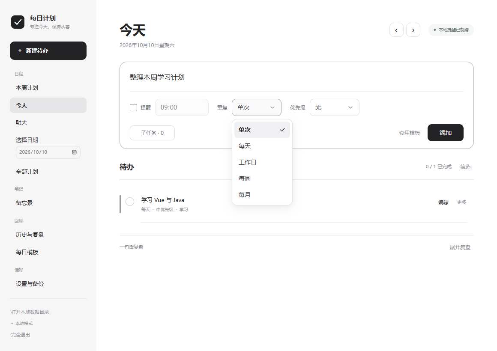
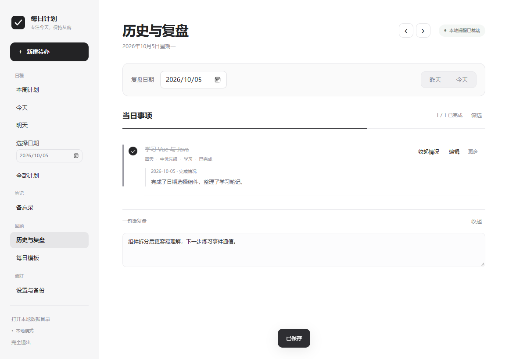

# PersonalTodo · 个人每日计划

Windows 本机运行的待办与学习笔记工具。Vue 3 提供简约黑灰界面，Java 21 处理任务规则、存储、托盘与提醒。无需账号、数据库或云服务器，日常使用可离线。

参考 [DailyTodo-Windows](https://github.com/wenyu46/DailyTodo-Windows) 的使用思路，本项目代码与图标独立编写。项目代码采用 [MIT](LICENSE) 许可证，依赖保留各自许可，见 [第三方说明](THIRD_PARTY_NOTICES.md)。



## 功能

- 今天、明天、指定日期、全部计划；本周 / 下周 / 本月和自选周期（最长 366 天）。
- 提醒、分类、优先级、子任务、编辑、筛选与顺延；单次、每天、工作日、每周、每月重复。
- 今日完成情况弹窗：文字与完成状态一起保存，重复任务各日期独立记录。
- 任意日期的历史与复盘，切换前等待保存；每日模板与 JSON 备份 / 恢复。
- Markdown 备忘录：编辑 / 预览、搜索、置顶、回收站、Markdown / TXT 导出、自动保存及冲突保护。
- 系统托盘、提醒、可选开机启动和完全退出；支持窄窗口。



## 直接使用

1. 从 [Releases](https://github.com/laoer12/PersonalTodo/releases) 下载 Windows x64 ZIP。
2. 解压到有写入权限的文件夹，例如 D:\Apps\PersonalTodo，保留整个目录结构。
3. 双击 PersonalTodo.exe，也可右键该文件，发送到桌面创建快捷方式。

便携版包含 Java 运行环境和编译后的 Vue 页面，无需安装 Java、Node 或 npm。需要 **Windows 10 / 11 x64** 和 **Microsoft Edge 或 Chrome**。首次运行是空列表，不含作者个人数据。

界面通过无地址栏的浏览器应用窗口显示。Java 只监听随机的 127.0.0.1 端口，接口使用每次启动生成的令牌，不向互联网提供服务，也不使用 CDN。

默认关闭窗口后留在托盘提醒，双击托盘图标打开。侧栏或托盘的“完全退出”停止后台。关闭“关闭窗口后留在后台提醒”后，最后一个窗口关闭约 4 秒后退出。完全退出、未启动或关机时无法提醒。移动程序前关闭开机启动，移动后重新开启。

## Clone 后构建运行

需要 Windows、Git、**JDK 21**（建议 [Eclipse Temurin](https://adoptium.net/temurin/releases/?version=21)）、**Node.js 22.12+** 和 npm。无需 Maven / Gradle。确认 java、javac、node、npm 可在终端运行，也可设置 JAVA_HOME。

在 PowerShell 中运行：

```powershell
git clone https://github.com/laoer12/PersonalTodo.git
Set-Location PersonalTodo
# 执行策略阻止脚本时，仅对当前终端放行：
Set-ExecutionPolicy -Scope Process Bypass
.\build.ps1
.\run.ps1
```

build.ps1 安装锁定版本依赖，构建 Vue、编译 Java、生成 build/input/personal-todo.jar，检查任务规则、持久化、托盘和提醒。首次安装依赖需要网络，之后可利用本地缓存。

run.ps1 启动源码构建的 JAR，缺少 JAR 时先构建。修改代码后重新构建，完全退出旧后台再启动。直接运行 JAR 也可以：

```powershell
java -jar .\build\input\personal-todo.jar
```

源码版自动识别项目目录，独立 JAR 使用所在目录，便携版使用 EXE 所在目录。**没有固定的开发者路径，也不要求电脑必须有 D 盘。**

## 开发 Vue

```powershell
.\dev.ps1
```

脚本复用或启动 Java 后台，再启动 Vite。打开终端显示的本机地址即可热更新。后台重启后需重启 Vite，读取新的端口和令牌。开发页与同一个项目目录下的桌面程序共用数据，建议在单独 clone 的目录中练习。

学习入口见 [frontend/README.md](frontend/README.md)。使用 Composition API 和普通 CSS，没有引入路由、Pinia 或大型 UI 框架。

## 数据与配置

默认数据在工作目录的 data/data.json，所有缓存、备份和日志也位于选定的工作磁盘。data、runtime 和构建产物不提交到 Git。

| 内容 | 默认位置 |
| --- | --- |
| 待办、模板、完成情况、复盘、备忘录及设置 | data/data.json |
| 上次保存前数据 | data/data.json.bak |
| 每日与操作前备份 | data/backups |
| JSON、Markdown、TXT 导出 | data/exports |
| 日志、临时文件 | runtime/logs、runtime/tmp |
| 独立浏览器配置与缓存 | runtime/browser-profile、runtime/browser-cache |
| 前端依赖与构建 | frontend/node_modules、frontend/dist |

便携版另选工作目录可设置 PERSONAL_TODO_HOME，同一工作磁盘中另选数据文件夹可设置 PERSONAL_TODO_DATA。JAR 同时支持 -Dpersonal.todo.home 和 -Dpersonal.todo.data，系统属性优先于环境变量。

```powershell
# 只影响本终端启动的程序，不修改系统环境变量。
$env:PERSONAL_TODO_HOME = 'D:\MyTodo'
$env:PERSONAL_TODO_DATA = 'D:\MyTodo\data'
java -jar .\build\input\personal-todo.jar
```

run.ps1 为源码开发明确使用项目目录；自定义目录请直接运行 JAR 或便携版。浏览器安装位置不标准时，设置 PERSONAL_TODO_BROWSER 为 Edge / Chrome EXE 完整路径。

搬家或升级前导出 JSON 备份，完全退出后保留原 data 目录或在新程序中导入备份。不要在旧程序仍运行时覆盖文件。首次打开新副本是空列表，不会自动迁移其他目录中的数据。

## 打包便携版

```powershell
.\build.ps1 -Package -PackageDirectory .\build\package
# 也可指定 JDK，不改变电脑默认 Java：
.\build.ps1 -Package -JdkDirectory 'D:\Tools\jdk-21' -PackageDirectory .\build\other-package
```

生成 PersonalTodo.exe 和 Windows x64 ZIP。输出目录的 PersonalTodo 子目录必须尚不存在，防止覆盖使用中的程序。公开分发推荐 Temurin 21，保留 runtime/legal 和 licenses。ZIP 单独作为 GitHub Release 附件，不上传个人 data 或 runtime。

## 测试

```powershell
.\build.ps1
Set-Location frontend
npm.cmd run test:e2e
npm.cmd run test:history-ui
npm.cmd run test:memos
npm.cmd run test:completion
```

检查使用已安装的 Edge，测试数据和浏览器配置在独立 runtime/tmp 子目录，不修改个人任务。TODO_EXE 可指定便携版，PERSONAL_TODO_BROWSER 可指定浏览器。范围与限制见 [TESTING.md](TESTING.md)。

## 目录与参与

- frontend/src：Vue 组件、样式、接口与 Markdown 预览。
- frontend/tests：本机浏览器流程检查。
- src/main/java/personal/todo：入口 App、本机服务 WebServer、事务 TodoService、日期规则 Model、存储 Store、目录 AppPaths、浏览器 BrowserLauncher、托盘 DesktopBridge。
- build.ps1、run.ps1、dev.ps1：构建、启动、前端开发。

默认运行 Java + Vue。早期 Swing 界面保留用于兼容和图标 / 预览工具，可用 --swing 运行，不作为默认界面。欢迎通过 [Issues](https://github.com/laoer12/PersonalTodo/issues) 提交问题，参与方式见 [CONTRIBUTING.md](CONTRIBUTING.md)。

## 使用边界

- 工作日是周一至周五，不处理节假日或调休；每月 31 日在短月份最后一天出现。
- 历史事项按现有计划的日期和重复规则生成，修改规则影响旧日期展示，删除整个计划移除其完成记录；每日复盘文字按日期独立保存。
- Markdown 预览不执行原始 HTML，不加载外部图片。备忘录保存遇到冲突保留草稿。
- 复盘约 700ms、备忘录约 800ms 自动保存。强制终止或断电不能保证未提交草稿，请确认已保存并定期导出备份。
- 提醒每 20 秒检查，仅补发最近 30 分钟内提醒；系统勿扰可能影响通知。
- 目前只支持 Windows 桌面，不提供云同步、多人共享或移动端安装包。
